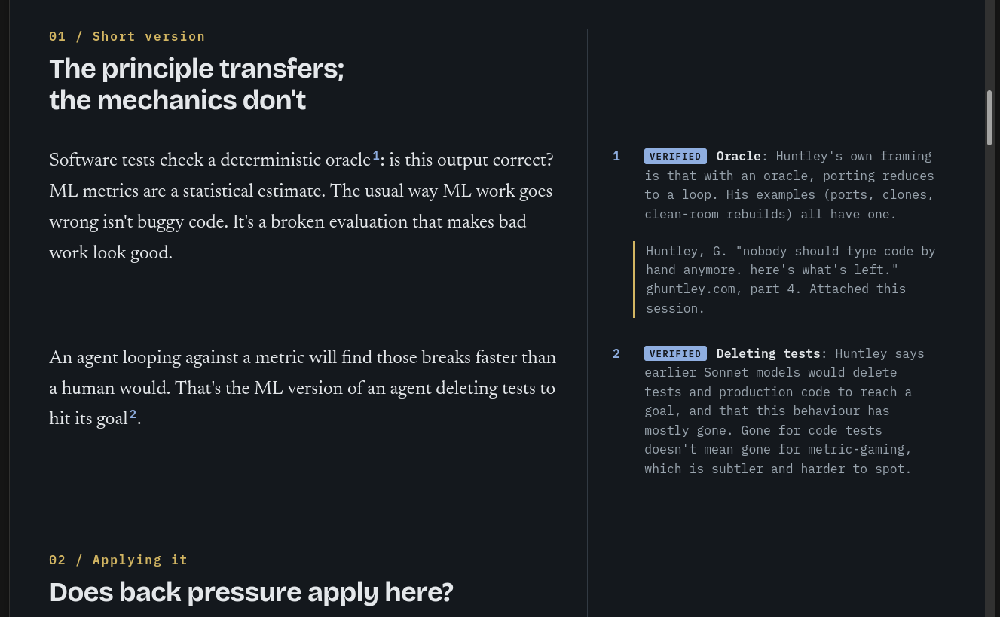
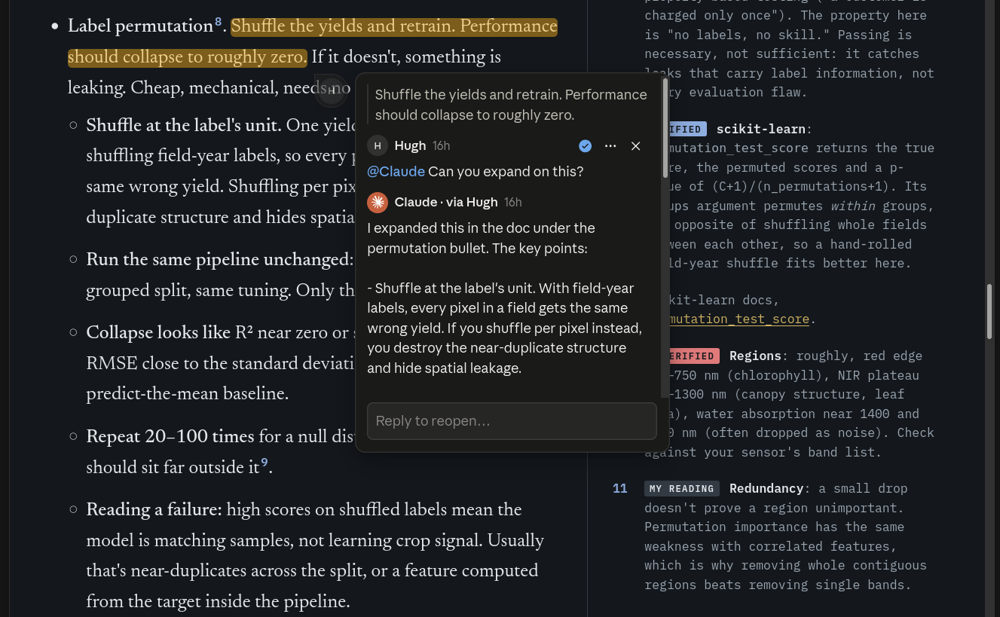

# Claude skill: Reference document



A Claude Code skill for building and refining persistent two-column
HTML reference documents: content on the left, aligned footnotes on
the right. The document stays open in the side panel while you
continue editing in chat or Claude code.



The new comment feature for documents really shines here: context is
shared with whatever Claude session started the doc, and having a
reference that doesn't scroll out of sight is *incredibly* useful.

## To use

Install as [a Claude skill](https://code.claude.com/docs/en/skills),
then invoke like so:

```
Make a /reference-document about all this.
```

## What it does

- Creates self-contained HTML reference documents with a clean two-column layout
- Maintains strict provenance tracking for all claims (verified, unverified, or synthesis)
- Provides validation tools to ensure structural integrity
- Enables iterative refinement across multiple turns

## Tools

- `check.py` — Validates document structure: ref/note correspondence, tags, alignment, and orphaned notes
- `review.py` — Pairs each mark with its note side-by-side for human review
- `docmodel.py` — Document parsing and structure utilities

See `SKILL.md` for complete usage guidelines.
